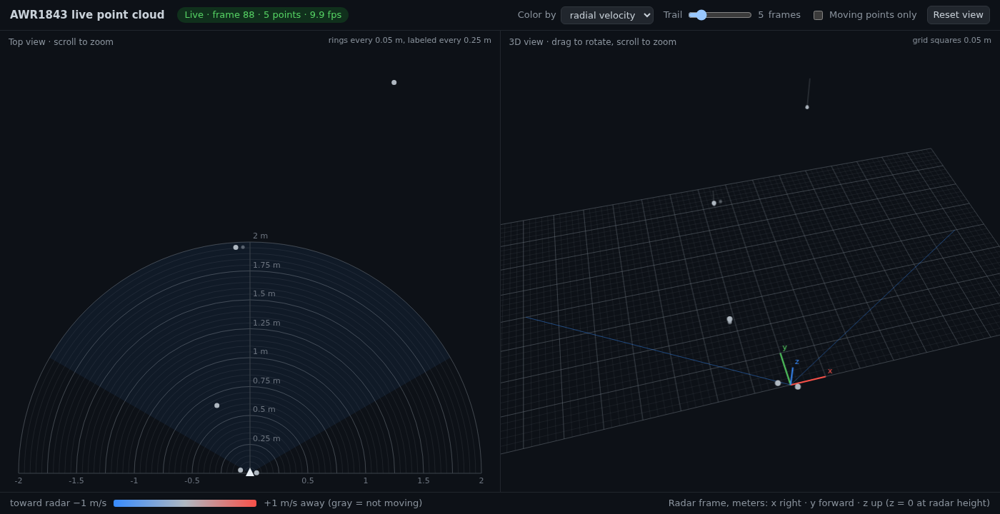

# Radar-guided TurtleBot3 navigation

Python radar acquisition/perception with ROS 2 Humble adapters for Jetson Orin Nano
and TurtleBot3 Waffle Pi. Physical acquisition/viewer were verified by the project
team; the new navigation integration is experimental and has not run on a robot.
Start with the [Jetson demonstration checklist](docs/JETSON_DEMO.md): measured TF,
real sensor probe, dry-output watchdog test, then operator-supervised reactive
motion. Humble middleware integration is tested with serial pseudo-terminals.

Architecture: one/two AWR1843BOOST → bounded serial parser → timestamped JSONL /
PointCloud2 (x, y, z, Doppler) → filtering and fixed-frame fusion → occupancy /
Nav2 obstacle observations. Existing live viewer functionality is preserved.

## Offline installation and validation

```bash
python3 -m venv .venv
. .venv/bin/activate
pip install -e .
python -m unittest discover -s tests -v
python -m radar_navigation.evaluate
python -m radar_navigation.simulate
```

Only pyserial is needed; core algorithms and tests use the standard library.
See [Jetson deployment](docs/DEPLOYMENT.md), [experiment protocol](docs/EXPERIMENTS.md),
and [engineering journal](PROGRESS.md) for exact status and remaining gates.

The core includes TLV validation/resynchronization, metadata preservation, explicit
dual-device acquisition, timestamped replay, finite/range/height/SNR gates,
temporal voxel confirmation, radial-motion distinction, planar calibration,
time-gated fusion, log-odds occupancy and an offline footprint-aware A* planner.
Temporal persistence is a multipath rejection heuristic, not a validated multipath
classifier. Default mapping marks occupied endpoints and leaves unobserved space
unknown; optional ray clearing is an experimental assumption. Static obstacles
are retained regardless of Doppler.

ROS adapters publish raw/filtered points, metadata, health and occupancy, and
require measured TF. Nav2 consumes the processed, aging occupancy grid through a local StaticLayer;
a merge script preserves the robot's validated controller parameters. A command
gate enforces fresh perception, fresh requests and an operator enable lease,
with a dry output by default. Prior-map AMCL localization is supported explicitly
as LiDAR-assisted localization. Autonomous physical validation and radar-only
localization remain open; the base/OpenCR must enforce its own command timeout.

## Original live viewer guide

### Radar point cloud viewer (AWR1843BOOST)

See the live point cloud from the TI AWR1843BOOST radar plugged into this Jetson. The viewer runs on the Jetson, and you watch it in a web browser on your laptop.

```text
AWR1843BOOST radar ──USB──► Jetson: radar_viewer.py ──port 8765, through SSH──► browser on your laptop
```



## Quick start

1. **On your laptop**, SSH into the Jetson with port 8765 forwarded:

   ```bash
   ssh -L 8765:localhost:8765 tejas@10.66.45.87
   ```

   If you use VS Code Remote-SSH, connect as usual instead; VS Code forwards the port for you.

2. **On the Jetson**, start the viewer:

   ```bash
   cd ~/radar_pointcloud
   python3 radar_viewer.py
   ```

3. **On your laptop**, open <http://localhost:8765>.

4. **To stop**, press Ctrl+C in the Jetson terminal. This also turns the radar off.

## Files

| File | What it is |
| --- | --- |
| `radar_viewer.py` | The viewer: configures the radar and serves the live page. |
| `radar_test.py` | Radar connection code the viewer uses. Run it on its own to print points in the terminal. |
| `awr1843_profile.cfg` | Radar settings sent at startup (range, frame rate, detection thresholds). |
| `viewer_screenshot.png` | What the page looks like. |

## Before you start

- **The radar is powered and its USB cable is plugged into the Jetson.** Check that the Jetson sees it:

  ```bash
  ls /dev/serial/by-id/ | grep XDS110
  ```

  You should see two lines, one ending in `-if00` (commands) and one in `-if03` (data).

- **Your account can open serial ports.** This should print `dialout`:

  ```bash
  groups | grep -ow dialout
  ```

  If it prints nothing, run `sudo usermod -aG dialout $USER`, then log out and back in.

- **Python 3 and pyserial.** Both are already installed on this Jetson. Elsewhere: `pip3 install pyserial`.

You don't need an Ethernet cable. The point cloud comes over the radar's USB cable.

## Start the viewer

```bash
cd ~/radar_pointcloud
python3 radar_viewer.py
```

It sends each line of `awr1843_profile.cfg` to the radar and prints `[OK ]` for each, then:

```text
Viewer running at http://localhost:8765   (Ctrl+C to stop)
```

If any line says `[ERR]`, see [Troubleshooting](#troubleshooting).

| Option | Default | Use it to |
| --- | --- | --- |
| `--cfg FILE` | `awr1843_profile.cfg` in this folder | Load different radar settings. |
| `--port N` | `8765` | Serve the page on a different port. |
| `--host ADDR` | `127.0.0.1` | Use `0.0.0.0` to let other computers open the page directly. |

## Open the page on your laptop

By default the viewer only accepts connections from the Jetson itself, so you reach it through your SSH connection.

**VS Code Remote-SSH.** VS Code sees port 8765 and forwards it for you. Ctrl+click (Cmd+click on a Mac) the link in the terminal, or open the **PORTS** tab (next to **TERMINAL**) and click the globe icon on the 8765 row. If 8765 isn't listed, click **Forward a Port** and enter `8765`. If the **Forwarded Address** column shows a different local port, use that one.

**SSH from a terminal.** Connect with a tunnel, then open <http://localhost:8765>:

```bash
ssh -L 8765:localhost:8765 tejas@10.66.45.87
```

The tunnel lasts as long as that SSH session. The Jetson's Wi-Fi address can change; run `hostname -I` on the Jetson to see the current one.

**Directly over the network.** Start the viewer with `python3 radar_viewer.py --host 0.0.0.0`, then open `http://<jetson-ip>:8765` on any computer on the same network. Anyone else on that network can open it too, so prefer an SSH tunnel on shared networks such as campus Wi-Fi.

## Keep it running after you disconnect

Closing the terminal stops the viewer and the radar. To run it in the background instead:

```bash
cd ~/radar_pointcloud
nohup python3 radar_viewer.py > viewer.log 2>&1 &
```

After a few seconds, `tail -n 2 viewer.log` should show `Viewer running at http://localhost:8765`.

```bash
pgrep -af radar_viewer                  # is it running?
pkill -f 'python3.*radar_viewer.py'     # stop it (also turns the radar off)
```

## Reading the page

- **Top view (left):** looking down on the radar, the triangle at the bottom. It opens showing 2 m ahead, with faint rings every 0.05 m and labeled rings every 0.25 m; the numbers along the bottom edge are left/right distance in meters. The shaded wedge is the ±60° field of view where the radar sees best.
- **Zooming:** scroll over either view. The ring and grid spacing adjust as you zoom (from 0.05 m up to 2 m), and the current spacing is shown in each view's top-right corner. If some points don't fit, a yellow note says how many; scroll out to see them.
- **3D view (right):** drag to rotate. The grid is the horizontal plane at the radar's height, in 0.05 m squares at the default zoom; thin lines drop from the newest points to it to show their height.
- **Color by:** *radial velocity* (gray = still, blue = moving toward the radar, red = moving away) or *height* relative to the radar.
- **Trail:** how many recent frames stay on screen, fading with age. The radar sends 10 frames per second with only a few points each, so 5–10 frames makes shapes easier to see.
- **Moving points only:** hides walls, furniture, and other still objects.
- **Reset view:** restores the default 2 m view and 3D camera.
- **Status** (next to the title): green while frames are arriving, with frame number, point count, and frame rate. Yellow means no frames are arriving; red means the page lost the viewer or the viewer lost the radar.

Coordinates are in meters, in the radar's frame: x to the right, y straight ahead, z up.

With the current `awr1843_profile.cfg`:

- The radar reports points out to about 8.9 m. Scroll out to see that far.
- Distance from the radar is measured in steps of about 4.4 cm, which is why the finest scale is 0.05 m. Left/right and up/down positions come from angle estimates and are much coarser.
- Speeds are measured only up to about ±0.65 m/s. Anything faster, like brisk walking, wraps around and can show the wrong color.

## Troubleshooting

| Problem | Fix |
| --- | --- |
| `Radar ports not found` | Check the radar's power and USB cable, then run `ls /dev/serial/by-id/`. |
| `Radar CLI is not answering` | Press the reset button on the radar board, wait a few seconds, and start again. If the board was just re-flashed, set its SOP jumpers back to functional mode. |
| `[ERR]` lines at startup | Press reset on the radar and start again. If you edited the `.cfg` file, check that this firmware (mmWave SDK 3.04) supports those commands. |
| `Address already in use` | A viewer is already running. Stop it with `pkill -f 'python3.*radar_viewer.py'`, or use `--port 8766`. |
| `Could not exclusively lock port` | Another viewer is using the radar. Stop it as above. |
| `Permission denied` on a serial port | Add yourself to the `dialout` group (see [Before you start](#before-you-start)). |
| Page says *Not connected to the Jetson* | The viewer stopped or your SSH tunnel closed. Restart whichever one is down. |
| Page stays on *Waiting for radar frames…* | Look for `[ERR]` lines in the viewer's output, press reset on the radar, and restart the viewer. |

Only one program can use the radar at a time, so don't run `radar_test.py` while the viewer is running.

## How it works

- The radar shows up as two serial ports: commands at 115200 baud (`…-if00`) and data at 921600 baud (`…-if03`).
- `radar_viewer.py` sends `awr1843_profile.cfg` over the command port one character at a time (the radar drops characters when a whole line arrives at once), then reads frames from the data port.
- It serves the page at `/` and pushes each frame to the browser as JSON at `/stream` (server-sent events). Nothing beyond Python 3 and pyserial is needed, and the page works without internet access.
