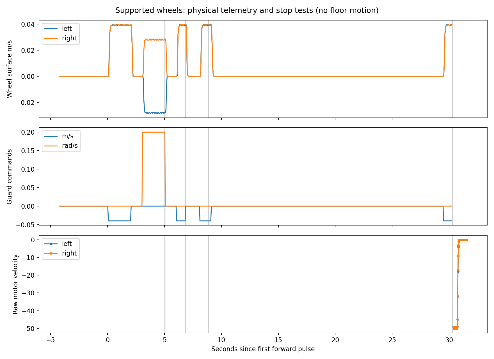

# November 8: verified radar-facing drive convention

This follow-up resolves the physical forward mismatch discovered after the
[initial supported-wheel stop tests](BASE_TEST_2026-11-08.md). All tests below
used the robot securely supported, both wheels clear, secured radar top plate,
12 V / 5 A external supply, and no chassis/floor movement.

## Observation, diagnosis and correction

Positive native forward rolled both tire tops away from an antenna-facing
observer. Positive yaw still looked like a left turn, which did not resolve the
forward ambiguity. Isolated native-channel pulses, with separately announced
clock times, established that native right was radar-left and native left was
radar-right, with positive motion backward in both cases. See the full
[coordinate derivation and TF tree](BASE_COORDINATES.md).

Retained stock TurtleBot3 driver/odometry/model rather than rewriting it or
changing motor IDs, wiring, drive-mode registers or firmware. Native geometry
has explicit frames. The command boundary, canonical wheel states, odometry and
covariances all use the measured coordinate relationship. Radar-facing +x is
canonical forward; the existing surveyed radar mount is unchanged and published
once. Static world/body coordinate bridges are distinct from the radar mount.

An initial corrected repeat was missed by the observer and was not accepted as
visual proof. The next repeat was scheduled 30 s ahead: 21:35:04 forward,
21:35:09 left turn, stopped/disabled 21:35:12 Eastern. Operator explicitly
confirmed both tops toward them for forward, observer-right away/observer-left
toward for left turn, and both stopped. Canonical encoders independently showed
+/+ forward and -/+ turning. This establishes physical direction on the stand.

## Corrected-path physical stop measurements

| Trigger | Measured stop time |
| --- | ---: |
| Explicit zero after turn | 0.212994 s |
| Enable false | 0.208881 s |
| Command producer SIGKILL, enable alive | 0.435325 s |
| Watchdog SIGKILL / native child heartbeat lost | 0.574868 s |

Three consecutive wheel velocities <=0.002 m/s define stopped, timestamp first
sample (~20 Hz). After base death, read-only serial polls use <=2 raw motor
velocity units, three consecutive samples (>=15 ms poll interval). Single trials,
not worst-case guarantees. Parent-death SIGKILL removed the serial-owning child;
OpenCR stopped while native linear register retained -4 (-0.04 m/s). No emergency
stop needed. This validates heartbeat expiry, not a firmware command-age timeout
while the native node keeps heartbeating, and not all partial host hangs.

In the two-second forward window canonical wheel angles changed 2.185923 and
2.184389 rad, encoder displacement 0.072110 m. Left turn integrated 0.360170 rad
with -0.000051 m mean translation. Median forward wheel surface speeds were
0.039568/0.039568 m/s; turn -0.028094/+0.027698 m/s. Geometry uses stock
0.033 m radius /0.287 m separation. Native/canonical transformation is checked
against TF; none of these encoder distances are ground-truth chassis displacement.

## Software, middleware and dry hardware checks

- Build 4.11 s; 36 offline tests passed in 1.784 s, including coordinate, covariance,
  leases/limits, parser/perception and real Linux parent-death tests.
- Required isolated-domain Humble integration passed in 10.648 s: 59 clouds,
  39 maps, dry stale-stop 0.251093 s. Localization gate passed in 4.218 s.
  These are middleware metrics, not physical stopping distances. Nav2 code/tests
  remained on the separate agent's branch.
- Warm dry comparison: 401 native/canonical odometry messages (~20 Hz), 200 source,
  201 processed clouds (~10 Hz), 100 maps (~5 Hz) in 20.011 s. Native/canonical
  conversion error zero; measurement-time TF agrees to floating-point precision.
  Sole canonical /odom publisher is base_frame_adapter; sole native dynamic
  odometry publisher remains diff_drive_controller. Mount .15/.06/.19, one publisher.
- Corrected final dropout test: enable release dry output zero in 0.006873 s;
  radar/odometry pauses set stale health and zero control, no processing >1 s into
  odometry dropout. Reader resume delivered 3 frames/0.25 s instead of the original
  13-frame backlog burst. Actual driver commands stayed zero throughout dry tests;
  enabled dry output reached 0.05 m/s and respected configured caps.

Final smoke: 20.016534 s, 401 native/canonical odom each, 200 source/processed
clouds each, 100 maps. All 401 conversion pairs and 400 measurement-time TF
comparisons had zero numerical error; all dry driver outputs zero.
Final steady-stream/TF smoke JSON is committed beside the corrected motor
summary in `results/base_alignment_20261108/`; see PROGRESS.md for final counts,
shutdown evidence and commit references. No floor navigation/accuracy is claimed.

## Evidence and next experiment

Root `/home/tejas/radar_integration_artifacts/base_development_20261108T1940/`:
`alignment_bag/`, `alignment_observations/`, `isolation2/` and `isolation2_bag/`,
`corrected_visual1/` (missed), `corrected_visual2/` (operator confirmed),
`lifted_motor_test_aligned/`, all previous native runs/bags, build/test/launch logs.
Compact JSON/plot and reproducible scripts are on GitHub; raw recordings remain
on Jetson. Reproduce with `scripts/analyze_lifted_test.py .../lifted_motor_test_aligned`.

Floor movement remains unauthorized. Next: fresh launch/map/odom on floor, broad
radar-visible obstacle at surveyed position, supervised straight-only <=0.03 m/s
trial bounded to <=6 s and <=0.18 m encoder travel, record radar-stop behavior and
physical tape-measured displacement/clearance. Require explicit floor approval,
clear area, untethered or safely managed power/USB, and accessible power cutoff.
First verify target detection and dry stop before enabling motors. Do not use the
stand-test helper on the floor. Turn/avoidance trials follow measured straight
stops and floor odometry/traction validation. Native IMU alignment/fusion and
hardware acquisition timing remain unvalidated; radar ego-Doppler compensation
is not implemented. Guard freeze with surviving native heartbeat remains a known
limitation despite validated process-death stops.
