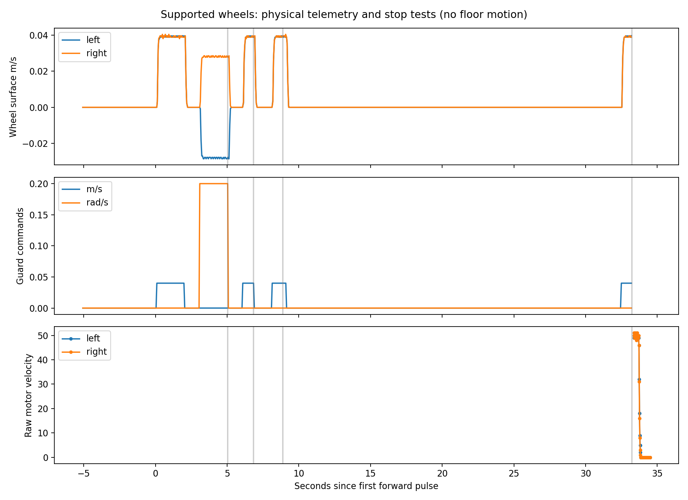

# November 8, 2026: OpenCR, odometry and supported-wheel validation

Physical Jetson/TurtleBot3 Waffle Pi/AWR1843BOOST, on a stable support with both
wheels clear. Operator confirmed secured top plate and 12 V / 5 A external supply.
No floor motion was performed. Nominal radar mount remains
(0.150,0.060,0.190) m from base_footprint, zero rotation.

## Direction mismatch discovered after encoder tests (subsequently resolved)

The operator’s second visual repeat found both tire tops moving away from the
radar-facing observer during commanded forward, while the left-turn directions
matched expectations. Encoder/odometry signs therefore do not prove correct
physical forward. All base processes were stopped during diagnosis; floor testing was blocked.
A native chassis/radar forward difference of 180 degrees is a hypothesis pending
physical marking/mount confirmation. No command-only sign inversion was applied.
The [measured coordinate adapter and physical retest](BASE_ALIGNMENT_TEST_2026-11-08.md)
subsequently resolved the direction mismatch. Floor motion remains unauthorized.
See PROGRESS.md for the full observation/diagnosis chronology.

## Hardware bring-up

OpenCR USB initially worked but reported motor status -1, disconnected/torque off,
with 12.02 V visible. The first reported reset did not reset uptime (~5.6 h).
After an actual OpenCR RESET with 12 V on: uptime 65.599 s, status 0, both motors
connected, torque on, 12.04 V. Read-only protocol-2 ID200 probe: model 0x5000,
model info 2, firmware register 5. No firmware flash or bus reconfiguration.

Installed turtlebot3_node 2.3.6 owns OpenCR through its watchdog parent. Correct
Humble unstamped Twist parameters are included in the repository. Stock wheel
radius 0.033 m / separation 0.287 m are defaults, not surveyed geometry.
Wheel-only odometry is deliberate: chassis yaw remains fixed on the support.
Actual odometry, joints, IMU and hardware telemetry publish approximately 20 Hz.

## Physical motor and stop results

Brief 0.04 m/s forward and +0.2 rad/s left-turn pulses produced both-positive and
left-negative/right-positive encoder signs respectively. Accepted corrected run:

| Condition | Time until measured stopped |
| --- | ---: |
| Explicit zero after turn | 0.2116 s |
| Enable false during forward pulse | 0.2578 s |
| Command producer SIGKILL, enable kept alive | 0.4292 s |
| Watchdog SIGKILL, native child killed by kernel | 0.5996 s |

Stop criterion: first of three consecutive joint velocity samples <=0.002 m/s,
or raw OpenCR velocities <=2 motor units after child death. ROS samples ~20 Hz;
raw serial polling interval >=15 ms. These are observed single-trial latencies,
not worst-case guarantees. Includes communication, motor deceleration and sampling.
No emergency stop was required. Serial port was free after guard death; native
child was killed via PDEATHSIG. OpenCR linear command register still read 4
(0.04 m/s), yet velocity became zero: independent board heartbeat expiry worked.
Upstream source suggests 500 ms heartbeat timeout, consistent with this result.
This does not prove a board command-age timeout while native heartbeat continues.

For the forward two-second window, encoder-integrated displacement was 0.07095 m;
for left turn, yaw increment was 0.35647 rad (0.00018 m mean translation). End-of-
pulse coasting is excluded from those windows. Median surface velocities were
+0.03878/+0.03878 m/s forward and -0.02770/+0.02770 m/s turning. Median instantaneous
odom twist was 0.03324 m/s forward and 0.16626 rad/s turning. Timing/quantization
makes instantaneous twist noisier than position integration. **The chassis did
not translate or yaw: none of these are ground-truth floor accuracy results.**



The first harness run aborted at its activity assertion because it assumed
JointState velocity rad/s rather than the installed driver's empirically observed
surface m/s. Its first stop estimate is invalid. Corrected thresholds and a new
run preserve both datasets. A later independent visual repeat was requested by
the operator; its confirmation is recorded in the engineering journal.

## Radar/control dry tests and fixes

With real radar and odometry, but base actuation disabled, dry reactive output
reached 0.05 m/s and respected 0.2 rad/s cap. All actual motor command outputs
remained zero. Owned-process SIGSTOP/SIGCONT tested radar and odometry loss.
Corrected observer: disable-to-zero 0.0147 s; sensor stale and odom stale caused
zero output, and no processed frames continued after the odom freshness window.
An earlier independently logged run measured radar-pause-to-zero ~0.300 s and
odom-pause-to-zero ~0.269 s. An isolated middleware dry watchdog test measured
0.2495 s stop on delayed odometry; that is a ROS test, not physical motor latency.

Reader resume initially replayed 13 buffered radar frames in 0.25 s, freshly
host-stamped despite age. Fixed by discarding UART/parser backlog after >0.2 s
polling stall, and publishing only the newest complete frame per ordinary read.
Physical repeat yielded 2 frames in the first 0.25 s; stale-health and odometry-
dropout checks passed. Source timestamps remain host receipt time, not measured
antenna acquisition time. Moving-radar Doppler compensation is not implemented.

Offline validation: 33 tests pass, including leases/caps/invalid commands and a
real Linux parent-death process test. A /proc disappearance race in test cleanup
was fixed after one failed final-suite run. Required Humble watchdog and
localization middleware tests pass; the separate Nav2 teardown issue was not
changed or used as a blocker. Final full composition passed: 401 odom (19.999 Hz), 201 source (9.996 Hz),
201 processed (10.029 Hz), 101 maps (5.004 Hz) in a 20.037 s interval.
All motor outputs zero in dry mode; one intended publisher per command interface
and expected TF ownership. Details are in compact JSON and PROGRESS.md. An initial smoke observer needed adaptation to Humble's one-argument
subscription callback; another assertion incorrectly excluded RSP's legitimate
moving-wheel /tf publisher. Neither issue was a runtime TF conflict.

## Artifacts and reproduction

Raw evidence stays outside Git:
`/home/tejas/radar_integration_artifacts/base_development_20261108T1940/`.
It includes `hardware_bag/`, line-by-line `observations.jsonl`, `events.jsonl`,
process/log metadata, register probes, upstream reference source,
`dry_hardware_validation_retry.json`, `lifted_motor_test/` (failed first run),
`lifted_motor_test_retry/` (accepted), and `visual_repeat/`.
Compact accepted summary and plot: `results/base_development_20261108/`.

```bash
python3 scripts/analyze_lifted_test.py /home/tejas/radar_integration_artifacts/base_development_20261108T1940/lifted_motor_test_retry
```

Limitations: ruler mount +/-1–2 cm, visually estimated angles; no floor wheel
radius/separation calibration, drift/traction/stopping-distance measurement,
physical autonomous obstacle avoidance, or global localization validation yet.
Guard death protection does not cover a frozen guard with a healthy native child.
Next is an explicitly approved supervised low-speed floor stop experiment with
real radar, fresh map/odom, bounded command duration and physical power cutoff.
