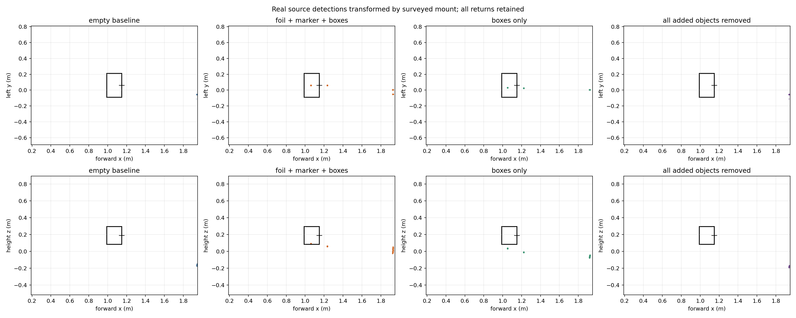
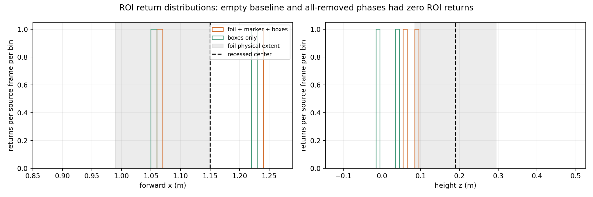
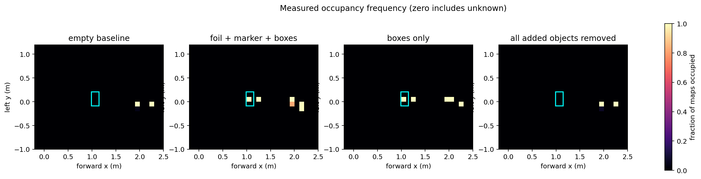
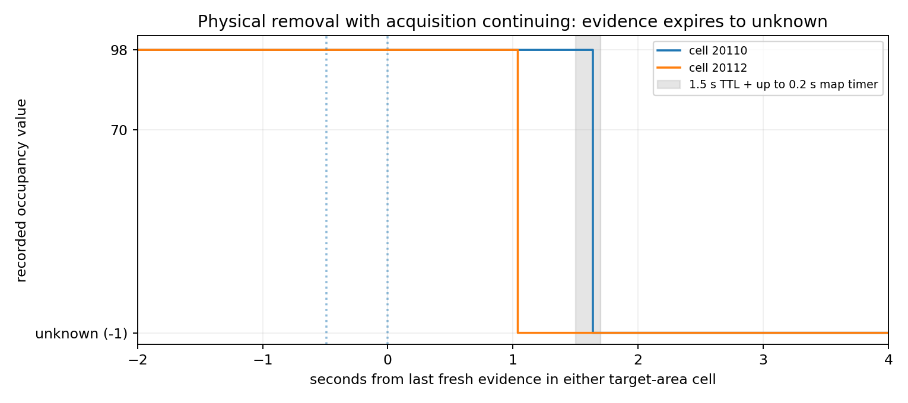

# Stationary top-plate experiment — 2026-11-08

The added target assembly was detected in every surveyed target-present frame.
The two target-area occupancy cells remained occupied after removing foil and
its attached marker while retaining the boxes. After the boxes were also removed,
both cells became unknown with acquisition still running: 1.529 s and 1.639 s
after their last fresh evidence. This validates observed marking and TTL expiry,
not isolated foil accuracy or safe robot movement.

## Revisions, deployment and preservation

- Jetson: ubuntu, aarch64, Ubuntu 22.04.5, ROS 2 Humble; physical domain 30.
- Perception runtime: `8077be6a5c1cbf996d914daf03203b3f5c6771ed`.
- Preserved driver: `9bee6926c19a846af50e3197726adbf625b8291b` in
  `/home/tejas/radar-bot-navigation`; no source/config/build changes there.
- Separate overlay: `/home/tejas/radar_integration_ws`.
- Old calibration `(0.036,-0.065,0.185)` remains in Wenqian's checkout; a copy
  is saved as `radar_mount_previous.yaml` in this experiment.
- New operator-measured translation `(0.150,0.060,0.190)` m relative to
  `base_footprint`, nominal zero roll/pitch/yaw. Ruler uncertainty +/- 1-2 cm;
  angles visually estimated with unquantified uncertainty.
- New mount was passed through the existing driver's `mount_file` argument.
  Live graph and bag showed one `radar_tf` mount publisher and one static
  transform with the new translation and identity rotation. No duplicate TF,
  invented odometry, motor/control launch, or movement command was used.
- Plate security for movement is explicitly unverified. Operator confirmed
  the robot/radar/original scene stayed stationary throughout.

## Conditions and timing

The operator corrected the scene history before baseline collection: earlier
data may contain the reflector. No earlier recording is treated as clean absent
ground truth. This fresh baseline began only after the correction and a logged
5.007 s absent-scene settling interval; no earlier data was deleted or relabeled.

| Condition | Source / processed frames | Source / processed Hz | Target ROI returns | Median occupied cells (whole map) |
| --- | ---: | ---: | ---: | ---: |
| Fresh empty scene | 301 / 301 | 10.0003 / 9.9990 | 0 | 7.0 |
| Foil + marker/cardboard + boxes | 301 / 301 | 10.0004 / 9.9997 | 602 | 13 |
| Boxes only | 370 / 370 | 10.0001 / 10.0003 | 740 | 11.0 |
| All added objects removed | 394 / 394 | 10.0000 / 9.9995 | 0 | 6 |


Acquisition and processed clouds stayed near 10 Hz, occupancy near 5 Hz. Every
phase had equal observed source/processed frame counts and no stale health
messages. Stage durations were approximately 30.15, 30.14, 36.97 and 39.38 s.
Transitions and operator delays are retained in the continuous recording but
excluded from stable phase comparisons. Phase timestamps are in `events.jsonl`.

The 30 x 21 cm foil opening had 16 cm cavity depth, faced the radar, and was
approximately upright. Operator confirmed that 1.00 m was measured from antenna
center to the **deepest recessed foil center**, not the front rim. Recessed
center: `(1.15,0.06,~0.19)` m; front rim approximately x=0.99 m. The conservative
physical foil box is x=[0.99,1.15], y=[-0.09,0.21], z=[0.085,0.295] m.
Target survey uncertainty is also +/- 1-2 cm; height is approximate.

The boxes were added after the empty baseline. The unsurveyed printed marker
on cardboard was behind/above and physically attached to the foil. The first
removal took **foil plus attached marker/cardboard**, retaining boxes. The second
removal took the boxes, restoring the operator-reported original room scene.
New returns therefore belong to the assembly comparison; they cannot all be
attributed to foil, marker, or support separately.

## Spatial observations and limits

The predefined analysis ROI pads the physical foil box by 0.12 m in x and 0.20 m
in y/z. Padding is an association window, not an accuracy acceptance tolerance.
There were zero source returns in this ROI in 301 baseline frames, two returns
per frame in all 301 target-present frames, two per frame in all 370 boxes-only
frames, and zero in 394 final cleared frames.

Baseline-contrast voxel association (0.1 m voxels; present-frame fraction >=20%,
increase over baseline >=20%) identified two stable modes:

| Return group | Median x/y/z (m) | Residual to recessed center dx/dy/dz (cm) | 3D center residual |
| --- | --- | --- | ---: |
| 1 | (1.061, 0.060, 0.092) | (-8.9, +0.0, -9.8) | 13.2 cm |
| 2 | (1.233, 0.060, 0.061) | (+8.3, +0.0, -12.9) | 15.3 cm |


These are residuals to the surveyed recessed center, **not point-target sensor
error**. The nearer mode is inside the foil's conservative physical envelope;
the farther mode lies about 8.6 cm outside that box, mostly behind it and somewhat
below it. The unsurveyed marker/supports, multipath and angular/elevation error
remain possible contributors, without a source-specific attribution claim.

In the boxes-only stage the two forward groups remained near x=1.053 and 1.222 m,
with median heights approximately 0.036 and -0.010 m. Target-present heights were
approximately 0.092 and 0.061 m, below the recessed-center height of 0.19 m.
Thus the removed assembly affected the measured elevations, but the remaining
supports continued to produce nearby planar obstacle evidence. Do not tune the
mount translation to make these mixed scatterers fit the recessed center.

The pooled median x=1.147 m falls between the two modes; its apparent 3 mm
agreement with x=1.150 m is misleading and is **not** a 3 mm accuracy result.
The centered target also does not establish left/right sign correctness or
general elevation accuracy. Nominal zero tilt and survey uncertainty limit
what this one-position extended-target experiment can establish.

## Occupancy and physical removal

Map: 200 x 200, 0.1 m cells, origin (-10,-10), fixed frame `base_footprint`.
Target-area cells 20110 and 20112 have centers (1.05,0.05) and (1.25,0.05) m.
They were occupied in >=50% target-present maps, <=5% baseline maps, and in
**100% of boxes-only maps**. Foil/marker removal alone therefore did not clear
these two obstacles; continuing box evidence refreshed them.

After all added objects were removed, actual bag values changed to -1 (unknown):

| Cell | Last fresh evidence, UTC | First unknown minus last fresh evidence | Occupied recurrence |
| --- | --- | ---: | ---: |
| 20110 | 2026-11-08T22:39:22.343+00:00 | 1.638813 s | 0 |
| 20112 | 2026-11-08T22:39:21.853+00:00 | 1.528898 s | 0 |

Both were unknown by 2026-11-08T22:39:23.982500+00:00, matching a 1.5 s evidence TTL
plus the 0.2 s map timer. Last fresh evidence was reconstructed from accepted
metadata through the unchanged filter, distinguishing fresh measurements from
its 0.5 s point-cloud history. Actual unknown values and header timestamps came
from the recorded OccupancyGrid, not a simulated map. Other room obstacles
continued to be reported and health stayed fresh during physical removal.

Exact hand-removal times were not supplied. Foil/marker action is bounded by a
130.51 s request-to-acknowledgement interval; box action by 58.57 s. The two cells
were already unknown about 26 s before the box-removal acknowledgement. The
acknowledgement is approximate and must not be used to claim 0.1 s clearing.
The 1.529/1.639 s values are **evidence-to-map-expiry**, not exact physical
removal latency. Unknown is not demonstrated free space.

## Plots









## Artifacts and reproduction

Jetson artifact root: `/home/tejas/radar_integration_artifacts/top_plate_20261108T1715`.
Continuous SQLite3 bag: `experiment_bag/`, 1,236.054 s, 285.9 MiB, 67,780 messages.
Source 12,324; raw/processed/metadata 12,313 each; status 12,343; occupancy 6,173;
static TF 1. Requested `/tf` had no publisher/messages. Different full-bag topic
counts include recorder discovery/transition effects; hardware frame counters
remain unavailable and no hardware gap count is inferred.

The raw bag, observations JSONL, complete logs, graph snapshot, event markers,
mount files, full analysis outputs and checksums remain outside Git. Compact
metrics, metadata and plots are in `results/top_plate_20261108/`. Earlier artifact
directory `8077be6_20261108T1622` is preserved unchanged.

Use the new calibration explicitly on future stationary launches:

```bash
source /opt/ros/humble/setup.bash
source /home/tejas/radar-bot-navigation/ros2_ws/install/setup.bash
source /home/tejas/radar_integration_ws/install/setup.bash
export ROS_DOMAIN_ID=30
ros2 launch awr1843_radar radar.launch.py mount_file:=/home/tejas/radar_integration_ws/src/radar_navigation/config/radar_mount_top_plate_20261108.yaml
# In a second sourced terminal:
ros2 launch radar_navigation cloud.launch.py
```

The driver's existing launch supplies the sole radar mount publisher. Do not add
a second static publisher. Wenqian's default mount file still records the old
mount, so omitting the explicit override would use the old calibration.

Reproduce analysis after sourcing the overlay (matplotlib and NumPy required):

```bash
python3 scripts/analyze_spatial_experiment.py /home/tejas/radar_integration_artifacts/top_plate_20261108T1715
python3 scripts/analyze_spatial_expiry.py /home/tejas/radar_integration_artifacts/top_plate_20261108T1715
```

Analysis invariants checked: unique mount publisher, absent command endpoints,
matched source/processed counts and ~10 Hz per phase, no stale status during
physical phases, no target-ROI returns in either clean absent phase, occupied
support-retained cells, actual -1 cell expiry in the configured TTL interval,
and no occupied recurrence in the analyzed final window. The physical collection
used unchanged runtime 8077be6; reporting/calibration/scripts do not alter its
perception algorithm. A NumPy scalar serialization error in report generation
was fixed and the complete analysis rerun; acquisition was unaffected.

All experiment processes were stopped cleanly and the radar ports released.
The driver emitted its existing rosout-context warning during shutdown after
logging `radar stopped`; this did not affect recording or physical phases.

## Next validation

Secure and remeasure the mount before movement. For spatial accuracy, use a
small surveyed reflector with an unchanged nonreflective support baseline, at
several forward/lateral/height positions; quantify angle alignment and repeatability.
This experiment demonstrates real assembly detection and evidence expiry while
also exposing extended-target/support ambiguity and elevation uncertainty.
No motion, stopping-distance, odometry or autonomous-navigation validation is
claimed. Use measurement-time odometry and `fixed_frame:=odom` for any future
authorized moving-robot experiment; never invent static odometry.
